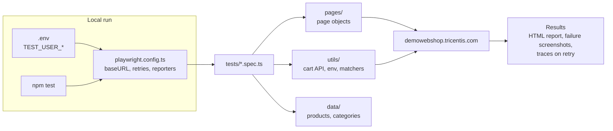
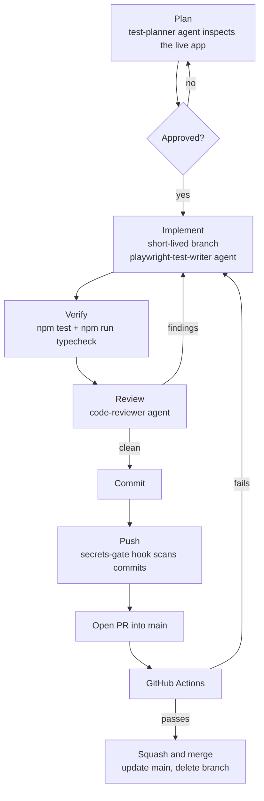
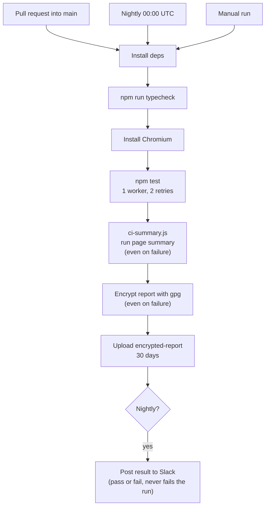

# Demo Web Shop Automation

UI and API test automation for https://demowebshop.tricentis.com/, built with
[Playwright Test](https://playwright.dev/) and TypeScript (strict mode).

## Setup

Requires Node.js (LTS).

```bash
npm ci
npx playwright install chromium
```

Install scripts of dependencies are blocked on purpose (`.npmrc` sets `ignore-scripts=true`),
so browsers are installed explicitly with the command above.

## Running

| Command | What it does |
|---|---|
| `npm test` | Run the Playwright tests (Chromium), except those tagged `@creates-data` or `@known-bug` |
| `npm run test:data` | Run only the `@creates-data` tests. They register real accounts on the shop, so run them on purpose, not in CI |
| `npm run test:known-bugs` | Run only the `@known-bug` tests. They assert correct behavior the shop does not have yet, so they fail by design while the bug exists. A pass means the bug was fixed |
| `npx playwright test tests/search.spec.ts` | Run a single spec |
| `npx playwright test --ui` | Run in UI mode |
| `npx playwright show-report` | Open the last HTML report |
| `npm run typecheck` | Type-check without emitting files |

The application base URL is set once, in `playwright.config.ts`.

## CI reports

The run page shows a summary (counts and failed tests). The full HTML report is attached to each
run as the encrypted artifact `encrypted-report`. To open it, you need the matching private key
in your gpg keyring:

```bash
gh run download <run-id> -n encrypted-report
gpg --decrypt report.tar.gz.gpg | tar xz
npx playwright show-report
```

## Test user

Tests that need a logged-in or existing account use one dedicated account on the shop,
created once by hand. Its credentials are never committed.

- **Locally:** copy `.env.example` to `.env` and fill in `TEST_USER_EMAIL` and
  `TEST_USER_PASSWORD`. `.env` is git-ignored.
- **CI:** add the same two names as repository secrets (Settings > Secrets and variables >
  Actions).

Tests that register a new account use their own unique fake email instead.

## Guards for Claude Code

Two hooks run inside Claude Code (see `scripts/hooks/`):

- `secrets-gate.js` runs before any `git push`. It scans the commits that are not on a remote
  yet and blocks the push if they add a literal credential or a token. This covers the main
  session and every agent.
- `writer-guard.js` is attached to the `playwright-test-writer` agent only. It limits that
  agent to editing `tests/` and to a short list of commands, so it cannot commit or push
  through its own commands. It is not a sandbox: a spec written under `tests/` is code that
  the tests run.

Both are limits, not guarantees. The gate is a pattern check: it misses unquoted values,
encoded secrets and values shorter than 4 characters, and neither hook covers pushes made
from your own terminal. For known token formats, also enable GitHub secret scanning with push
protection.

## Project layout

```
tests/
  *.spec.ts                 Specs: cart, login, password-recovery, register, search
  pages/                    Page objects (cart, gift card form, header, login)
  utils/                    Helpers: cart API calls, env, custom matchers
  data/                     Test data: products and categories
scripts/
  ci-summary.js             Builds the run summary shown on the GitHub Actions page
  hooks/                    Claude Code hooks (secrets gate, writer guard)
playwright.config.ts        Test configuration and base URL
tsconfig.json               TypeScript strict config
.github/workflows/          CI: typecheck, tests, summary, encrypted report, Slack
.claude/                    Claude Code settings and project agents
CLAUDE.md                   Project conventions
```

## How it fits together



## Development flow



## CI flow



## Conventions

See [CLAUDE.md](CLAUDE.md). In short: tests are independent and focus on business
behavior, use role/label locators and Playwright's auto-waiting, and never use real
payment data or perform real purchases.

## Continuous integration

GitHub Actions runs `npm run typecheck` and `npm test`:

- on every pull request into `main`;
- every night at 00:00 UTC, on `main`;
- on demand for any pushed branch: `gh workflow run playwright.yml --ref <branch>`, or
  Actions > Run workflow in GitHub. Manual runs work once the workflow is on `main`.

A push to `main` does not start a run by itself. The pull request run covers the change and
the nightly run re-checks `main`.

## Workflow

Work happens on short-lived branches and lands through pull requests (squash and merge).
